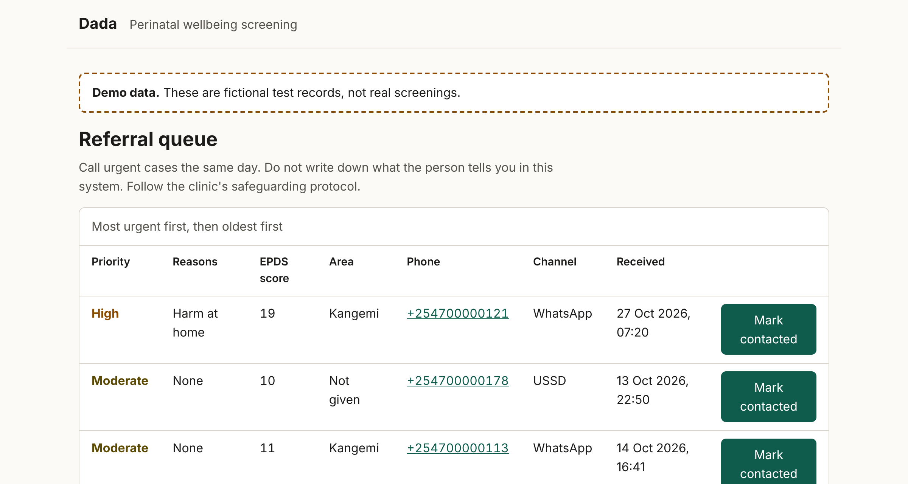
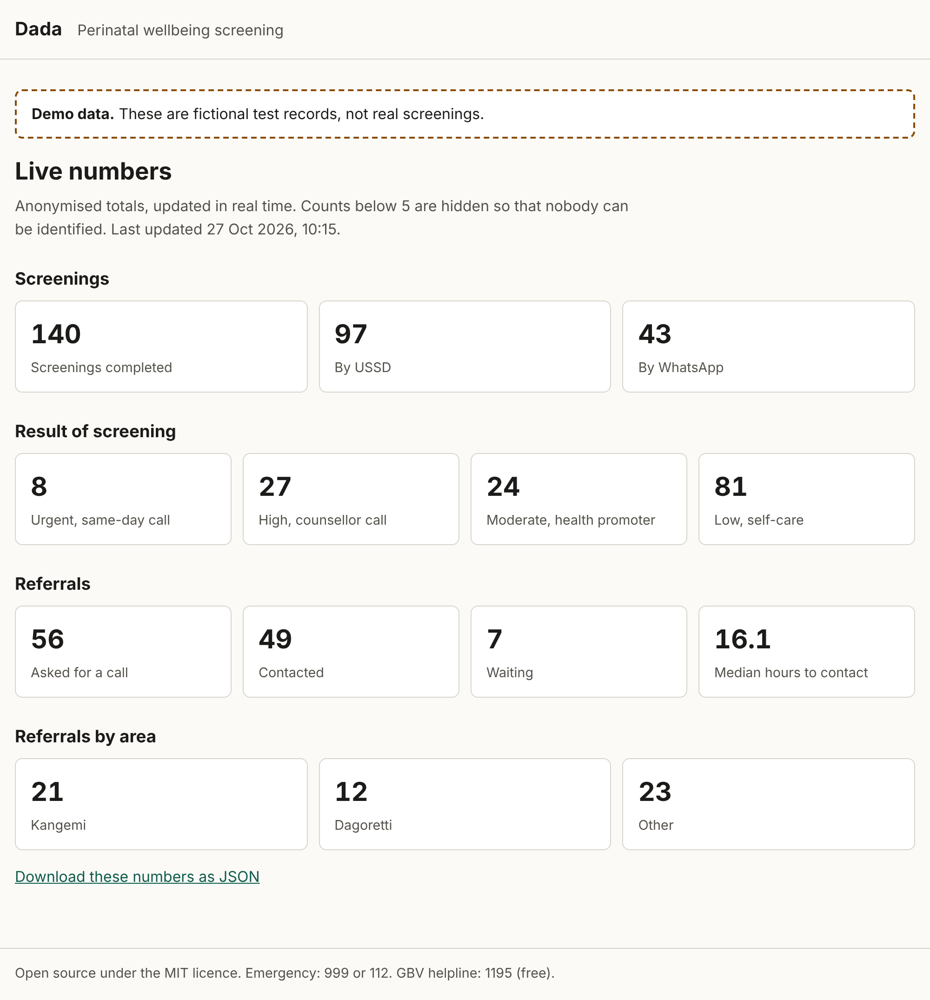

# Dada

[](https://github.com/Kevin-0j/Dada_FemTECH/actions/workflows/ci.yml)
[](LICENSE)

Dada helps pregnant women and new mothers in Nairobi's informal settlements check how they are
feeling, in Sheng, Swahili or English, on any phone. When someone is struggling or unsafe, Dada
connects her to a community health promoter or a counsellor who calls her back.

It works over USSD, so it runs on a basic feature phone with no internet, and over WhatsApp for
women who have a smartphone.

> **Project status:** pilot-ready software, not yet in clinical use. The Sheng and Swahili
> questions are drafts that are being validated with mothers and clinicians. See
> [Clinical content](docs/clinical-content.md).

## Contents

- [Why Dada exists](#why-dada-exists)
- [How it works](#how-it-works)
- [What it looks like](#what-it-looks-like)
- [Try it on your computer](#try-it-on-your-computer)
- [Connect a real USSD code and WhatsApp number](#connect-a-real-ussd-code-and-whatsapp-number)
- [Safety and privacy](#safety-and-privacy)
- [How AI is used, and where it is not](#how-ai-is-used-and-where-it-is-not)
- [Project layout](#project-layout)
- [Development](#development)
- [Roadmap](#roadmap)
- [Contributing](#contributing)
- [Licence and acknowledgements](#licence-and-acknowledgements)

## Why Dada exists

Depression during pregnancy and in the first year after birth is common, and in low-income
settings it is rarely noticed. Community health promoters visit mothers at home, but they have no
quick way to recognise depression or hidden violence. Many women share one phone with their
family, do not have mobile data, and will not talk about these things face to face with a
neighbour.

Dada gives them a private way to answer a short, recognised questionnaire in the language they
actually speak, and a way to ask for help without having to explain themselves first.

## How it works

1. A mother dials the USSD code or sends any message to the WhatsApp number.
2. She picks Sheng, Swahili or English and agrees to continue. She can leave at any time by
   sending 0.
3. She answers the 10 questions of the
   [Edinburgh Postnatal Depression Scale](docs/clinical-content.md) and two short safety
   questions.
4. Dada works out a level of risk:

   | Level    | When                                            | What Dada offers                                                                  |
   | -------- | ----------------------------------------------- | --------------------------------------------------------------------------------- |
   | Urgent   | Any thought of self-harm, or not safe right now | A counsellor call the same day, with 999, 112 and the 1195 GBV helpline on screen |
   | High     | Score of 13 or more, or harm at home            | A counsellor call                                                                 |
   | Moderate | Score of 10 to 12                               | A call and home visit from a community health promoter                            |
   | Low      | Score under 10                                  | Self-care advice, and a call if she wants one                                     |

5. If she wants a call, she can choose the number to be called on, which matters on a shared
   phone, and her area.
6. The case appears in a password-protected queue for counsellors and health promoters, most
   urgent first.
7. Anonymous totals are published on a public page, so partners and funders can follow progress
   in real time.

On WhatsApp she can answer in her own words, for example "saa zingine" (sometimes) or "mara mob"
(very often). If she writes something that suggests she is in danger, Dada stops the questions
and offers an urgent call straight away.

## What it looks like

A USSD session on a basic phone, in Sheng:

```
Karibu Dada.                     Umekuwa na huzuni mpaka hulali?
1 Sheng                          1 Mara mob
2 Kiswahili                      2 Saa zingine
3 English                        3 Si sana
0 Toka/Exit                      4 Never
                                 0 Toka
```

The staff referral queue:

These screenshots use fictional demo data, created with `npm run seed:demo`. In demo mode every
page carries a "Demo data" banner so it cannot be mistaken for real results.



The public live numbers page:



Both pages work without JavaScript, adapt to small screens, support dark mode and pass an
automated WCAG 2.2 AA check with no issues.

## Try it on your computer

You need [Node.js](https://nodejs.org) 22.18 or newer. Nothing else: the database is built into
Node.

```bash
git clone https://github.com/Kevin-0j/Dada_FemTECH.git
cd Dada_FemTECH
npm install
cp .env.example .env
```

Open `.env` and fill in the keys. You can generate each one with:

```bash
node -e "console.log(require('crypto').randomBytes(32).toString('base64'))"
```

Start the server:

```bash
npm run dev
```

In a second terminal, try the USSD flow with the built-in phone simulator. Type the number of
your answer and press Enter:

```bash
npm run simulate
```

Then open:

- `http://localhost:3000/staff` for the referral queue (use `STAFF_USER` and `STAFF_PASSWORD`)
- `http://localhost:3000/stats` for the live numbers

To fill the pages with fictional records for a demo, set `DEMO_MODE=true` in `.env`, run
`npm run seed:demo` and restart. Demo mode is refused when `NODE_ENV=production`.

## Connect a real USSD code and WhatsApp number

Dada uses [Africa's Talking](https://africastalking.com) for USSD and
[Twilio](https://www.twilio.com/whatsapp) for WhatsApp. Both have free sandboxes for testing.
Step-by-step instructions, including HTTPS and backups, are in the
[deployment guide](docs/deployment.md). To record a demo, follow the [demo guide](docs/demo.md).

## Safety and privacy

Dada is built for women who may share a phone with the person hurting them. The main protections:

- **Nothing left on the phone.** USSD keeps no message history, every screen has an exit, and the
  goodbye message is neutral.
- **Answers are never stored.** They stay in memory for the length of the conversation only. We keep
  the risk level and score, without any identifier.
- **Phone numbers are encrypted.** A number is stored only when a woman asks for a call, and it is
  encrypted with AES-256-GCM.
- **Small numbers are hidden.** The public page hides any count below 5.
- **Old data is deleted.** Referrals are removed 90 days after contact by default.
- **A person always follows up.** Dada screens and refers. It never diagnoses and never handles a
  crisis on its own.

Running Dada safely also needs trained staff and a written protocol. Read
[SAFEGUARDING.md](SAFEGUARDING.md) before any pilot, and [SECURITY.md](SECURITY.md) for technical
details and how to report a vulnerability.

## How AI is used, and where it is not

We keep AI to the narrow job it does well, and keep people in charge of decisions about risk.

| Task                                                   | Who does it                                                                                                                                            |
| ------------------------------------------------------ | ------------------------------------------------------------------------------------------------------------------------------------------------------ |
| Spotting words that suggest danger                     | Fixed rules, reviewed by the clinical lead. Runs first, on every WhatsApp message.                                                                     |
| Understanding a free-text answer such as "saa zingine" | Built-in Sheng, Swahili and English phrase rules                                                                                                       |
| Free-text answers the rules cannot place               | An optional language model, which can only pick one of the four answers or say it is unsure. It sees the question and the reply, never a phone number. |
| Deciding the level of risk                             | The published EPDS scoring and cut-offs set by the clinical lead                                                                                       |
| Deciding what happens next                             | A trained counsellor or health promoter                                                                                                                |

The model is optional and can be any OpenAI-compatible endpoint, including an open model you host
yourself. Without it, Dada asks the user to reply with a number.

## Project layout

```
src/
  domain/        Questionnaire, scoring, risk, danger phrases and the conversation (pure logic)
  contracts/     Interfaces the application depends on
  application/   Use cases: handle a message, manage referrals, build statistics
  adapters/      HTTP, SQLite, encryption, language model, notifications
  compose.ts     Wires everything together
  main.ts        Starts the server
tests/           Unit, application and HTTP tests
scripts/         USSD phone simulator
docs/            Architecture, deployment, clinical content, demo guide, DPG alignment
```

The [architecture guide](docs/architecture.md) explains the design and the reasons behind it.

## Development

| Command            | What it does                                                               |
| ------------------ | -------------------------------------------------------------------------- |
| `npm run dev`      | Start the server and restart on changes                                    |
| `npm test`         | Run the tests                                                              |
| `npm run check`    | Type-check, lint, check formatting and run tests with coverage, as CI does |
| `npm run simulate` | USSD phone in the terminal                                                 |
| `npm run build`    | Compile to `dist/`                                                         |

The code is written in strict TypeScript and run directly by Node.js. Every outside input is
validated with [zod](https://zod.dev). The tests run against a real in-memory database and real
HTTP requests, and they check that every USSD screen fits in 182 characters in all three
languages.

## Roadmap

- Validate the Sheng and Swahili questions with mothers and clinicians, and publish the results.
- Pilot in Kangemi and Dagoretti with trained community health promoters.
- Release the consented Sheng and Swahili answer phrases as an open dataset.
- Add a view for health promoters to record home visits.
- Explore links with Kenya's electronic Community Health Information System.

## Contributing

Help is welcome, especially from people who speak Sheng or Swahili and can tell us when a question
sounds wrong. Start with [CONTRIBUTING.md](CONTRIBUTING.md) and the
[Code of Conduct](CODE_OF_CONDUCT.md).

Dada is designed to meet the [Digital Public Goods Standard](docs/dpg-alignment.md).

## Licence and acknowledgements

Dada is open source under the [MIT licence](LICENSE).

The questionnaire is the Edinburgh Postnatal Depression Scale: Cox, J.L., Holden, J.M. and
Sagovsky, R. (1987). _British Journal of Psychiatry_, 150, 782-786.

## Who is behind Dada

| Organisation                                       | Role                                                                                                                     |
| -------------------------------------------------- | ------------------------------------------------------------------------------------------------------------------------ |
| VIPS Health Services, Nairobi, led by Dr Tom Olewe | Clinical partner. Owns the screening protocol, the counsellors who return calls and safeguarding.                        |
| Uwezo Link Initiative                              | Builds and maintains the software, and works with community health promoters to introduce Dada in Kangemi and Dagoretti. |

If you are in danger in Kenya, call 999 or 112. The national GBV helpline, 1195, is free
and open 24 hours.
