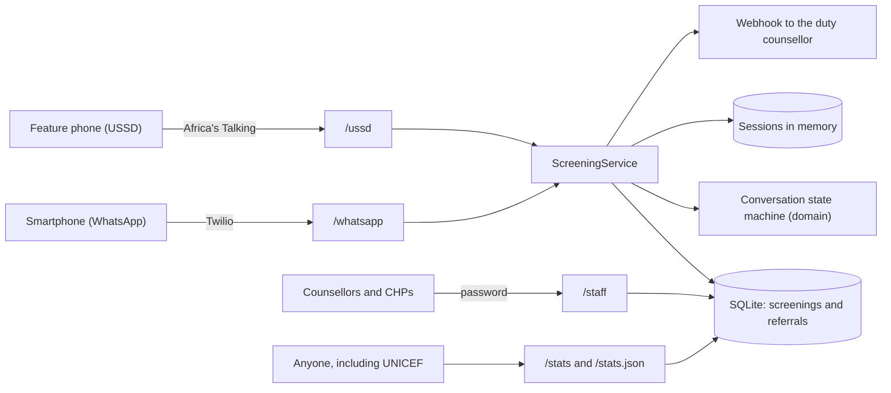

# Architecture

Dada is one small Node.js service. It has no front-end build, no message queue and one SQLite
file, so a single developer can run it, read all of it and host it cheaply.

## The parts



In words: USSD and WhatsApp messages arrive at two endpoints. Both pass the text to the same
`ScreeningService`, which moves the conversation forward using a pure state machine and keeps the
conversation in memory. When a screening finishes, an anonymous result is saved. When a user asks
for a call, a referral with her encrypted phone number is saved and the duty counsellor is
notified. Staff work through referrals at `/staff`. Anyone can see anonymised totals at `/stats`.

## Layers

| Layer       | Folder                          | May depend on     | Does                                                                     |
| ----------- | ------------------------------- | ----------------- | ------------------------------------------------------------------------ |
| Domain      | `src/domain`                    | nothing           | Questionnaire, scoring, risk tiers, danger phrases, the conversation     |
| Contracts   | `src/contracts`                 | domain types      | Interfaces for storage, encryption, hashing, interpreters, notifications |
| Application | `src/application`               | domain, contracts | Handle a message, manage referrals, build statistics                     |
| Adapters    | `src/adapters`                  | everything above  | HTTP, SQLite, crypto, language model, webhooks                           |
| Composition | `src/compose.ts`, `src/main.ts` | everything        | Wiring and start-up                                                      |

## The conversation

The state machine in `src/domain/screening.ts` takes the current session and one input and returns
the next session, the reply text and any events. It does no input or output. That makes every
path easy to test and lets USSD and WhatsApp share exactly the same logic.

```
language -> consent -> EPDS item 1 ... item 10 -> harm at home? -> safe now?
   -> offer (wording depends on risk)
       -> no: goodbye with helpline numbers
       -> yes: call this number? -> (another number) -> area -> referral saved
A danger phrase on WhatsApp, at any point, jumps straight to an urgent offer.
"0" at any point ends the conversation with a neutral goodbye.
```

Events returned by the state machine:

- `screening_completed`: saved as an anonymous record (risk tier, score, channel, time).
- `referral_requested`: saved with the encrypted callback number, the flags and the area.

## Understanding free text on WhatsApp

1. The danger phrase rules run first on every message.
2. If the reply is a number or a yes/no word, it is used directly.
3. Otherwise the rule-based interpreter looks for everyday Sheng, Swahili and English phrases
   such as "saa zingine" or "mara mob".
4. Only if the rules are unsure, and a model is configured, an OpenAI-compatible language model is
   asked to pick an option or say it is unsure. It sees the question and the reply, nothing else.
5. If nobody is sure, the user is asked to reply with a number.

## Why these choices

- **Sessions in memory, not a database.** Answers are the most sensitive data we touch. Keeping
  them in memory means they are gone when the conversation ends or the server restarts.
- **SQLite through `node:sqlite`.** No native build step and one file to back up. If a deployment
  outgrows it, the `CaseRepository` interface is the only thing a new database adapter must
  implement.
- **Hono.** A small, well-maintained web framework with the middleware we need (basic auth, CSRF,
  security headers) and fast tests through `app.request`.
- **Server-rendered HTML.** The staff and stats pages work on old phones and slow networks and
  need no JavaScript.
